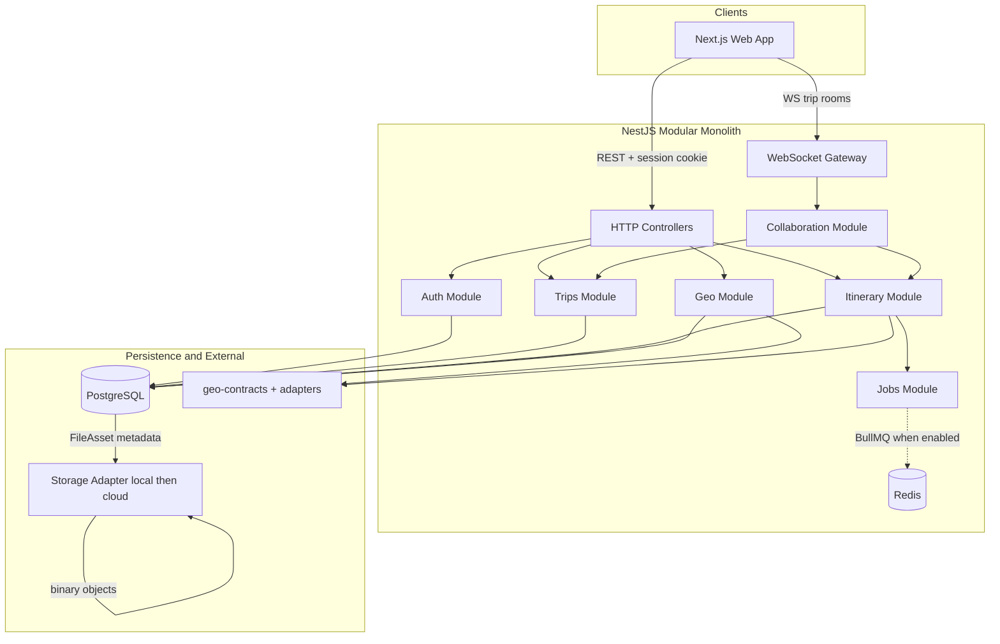
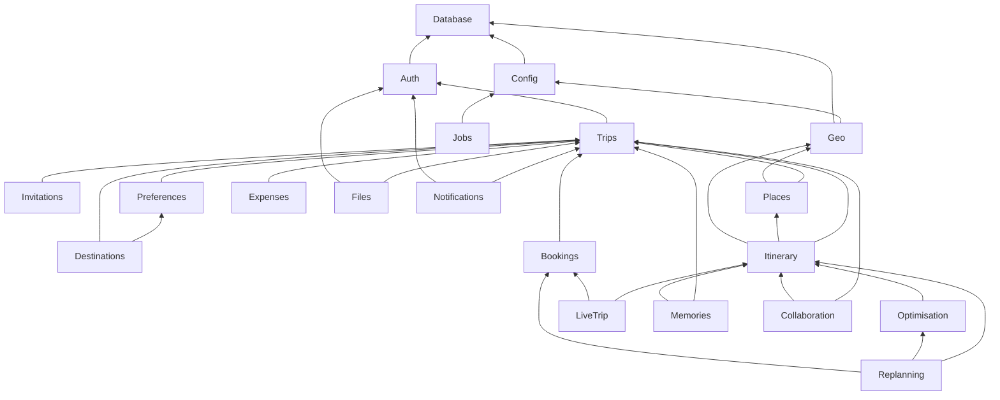

# Roamly — System Architecture

Implementation-ready blueprint for a **modular monolith**: NestJS (`apps/api`), Next.js (`apps/web`), PostgreSQL via Prisma, optional Redis/BullMQ for justified async work.

## Architectural overview

PostgreSQL is the **source of truth**. WebSockets notify clients **after** successful commits. External geo providers are **replaceable adapters**; stub mode keeps saved trips usable.

## Architecture principles

| Principle | Implementation |
|-----------|----------------|
| Modular monolith | One deployable API; explicit Nest module exports |
| Logic out of controllers | Controllers validate → services → repositories |
| Testable algorithms | `@roamly/itinerary-engine` without Nest/Prisma/geo SDKs |
| DB-first writes | All durable changes in PostgreSQL transactions |
| WS after commit | CollaborationService emits only post-commit |
| Trip isolation | Server-side membership + RBAC on every trip resource |
| Itinerary audit | `Trip.itineraryRevisionNumber` + `TripRevision` rows |
| Provider resilience | Stub geo provider; cache; degrade search/routing only |
| No AI in core rules | Deterministic scoring and replan heuristics |
| No circular modules | Dependency graph enforced (see below) |

## Authentication versus authorization

| Layer | Responsibility | Mechanism |
|-------|----------------|-----------|
| **Authentication** | Prove user identity | Session cookie → lookup `Session.tokenHash` → `userId` |
| **Authorization** | Permit action on resource | `TripMember` row + `role`; optional `@TripRoles('organizer')` |

Unauthenticated requests receive **401**. Authenticated but non-member receives **403**. Wrong role receives **403** with stable error code. Trip id in URL never grants access without membership query.

### Session flow

1. Login/register verifies credentials → create session row with hashed token → `Set-Cookie` httpOnly.
2. Each request: hash cookie token → load session if not expired → attach user to request context.
3. Logout deletes session; “logout all devices” deletes all sessions for user.
4. Mutating requests include CSRF token; origin header validated against allowlist.

## Role-based access control (initial matrix)

| Action | organizer | member | viewer |
|--------|:---------:|:------:|:------:|
| View trip workspace | ✓ | ✓ | ✓ |
| Edit preferences / vote | ✓ | ✓ | — |
| Edit itinerary | ✓ | ✓ | — |
| Manage expenses | ✓ | ✓ | — |
| Invite / change roles | ✓ | — | — |
| Approve replan proposal | ✓ | — | — |
| Trip status (planning → active) | ✓ | — | — |
| Archive / delete trip | ✓ | — | — |

Fine-grained policy tweaks stay in trip services; guards enforce coarse roles.

## Module boundaries and dependency rules

Modules **export services** consumed by others; they do **not** import peer controllers. **No circular imports.**

| Module | Responsibility |
|--------|----------------|
| **Config** | Env validation, feature flags |
| **Database** | PrismaService, transaction helper |
| **Auth** | User, Session, password, CSRF helpers, session guards |
| **Trips** | Trip CRUD, TripMember, lifecycle, **`itineraryRevisionNumber`** |
| **Invitations** | TripInvitation, accept/decline (idempotent) |
| **Preferences** | MemberPreference |
| **Destinations** | DestinationCandidate, Poll, Vote, snapshot persistence |
| **Geo** | Provider registry, Geoapify adapter, stub, response cache |
| **Places** | Place canonicalization, SavedPlace |
| **Itinerary** | TripDay, ItineraryItem, participants, revision transactions |
| **Optimisation** | Conflict reports, order suggestions (calls engine) |
| **Expenses** | Expense, splits, settlement suggestions |
| **Bookings** | Manual bookings, **confirmed** flag for replan protection |
| **Files** | FileAsset metadata, **StorageAdapter** |
| **LiveTrip** | Today read model |
| **Replanning** | Proposals, approval apply, booking/lock preservation |
| **Memories** | TripMemory, template clone rules |
| **Notifications** | In-app notification records |
| **Collaboration** | WS gateway, room auth, post-commit emit |
| **Jobs** | BullMQ producers/consumers when Redis enabled |

**Shared packages:** `@roamly/shared`, `@roamly/itinerary-engine`, `@roamly/geo-contracts`.

## Database transaction boundaries

| Operation | Transaction scope |
|-----------|---------------------|
| Itinerary mutation | Update items/days + insert `TripRevision` + increment `Trip.itineraryRevisionNumber` — **one transaction** |
| Replan approve | Apply patch + new revision + update proposal status — **one transaction** |
| Accept invite | Mark invitation + insert TripMember — **one transaction** |
| Expense + participants | Insert expense + participants + recompute settlements — **one transaction** (or sync recompute in same TX) |
| Recommendation snapshot | Insert snapshot after compute (compute may be in-memory; persist atomically) |
| File upload | Insert FileAsset then stream to storage; on storage failure **rollback** DB row |

Cross-module calls use injected services participating in the same `Prisma.$transaction` callback where needed.

## Optimistic concurrency

- Client reads `itineraryRevisionNumber` with trip/itinerary payload.
- Mutations send `expectedRevision`.
- If `expectedRevision !== Trip.itineraryRevisionNumber` → **409** with `{ currentRevision, message }`.
- Client refetches and retries user action; no silent last-writer-wins on itinerary.

Optional HTTP `If-Match: W/"<revision>"` mirror for GET/HEAD caching — body field is canonical for API v1.

## Idempotency for retryable operations

| Case | Approach |
|------|----------|
| Invitation accept | DB unique `(tripId, userId)`; second accept returns existing membership |
| Vote | Unique `(pollId, userId)` |
| Expense POST retry | Client `Idempotency-Key` → stored response replay within TTL |
| Itinerary POST | Revision gate; client must update `expectedRevision` after 409 |

## Background jobs (Redis + BullMQ)

Introduced when justified (routing matrix prefetch, heavy replan analysis, batch notifications).

- **Producers** in Itinerary/Replanning modules enqueue typed jobs.
- **Workers** in Jobs module; inject domain services; **no duplicate side effects** without idempotency keys.
- **Retries:** exponential backoff; max attempts documented in ENGINEERING_DECISIONS.
- **Failure:** job marked failed; itinerary state unchanged until explicit apply endpoint succeeds.

Synchronous path remains valid for small trips when queue disabled.

## Request flow: itinerary mutation

1. `SessionAuthGuard` + `TripMembershipGuard` + role check.
2. Validate DTO (Zod) including `expectedRevision`.
3. `ItineraryService.mutate()` inside `$transaction`:
   - Lock trip row (`SELECT FOR UPDATE`) or compare revision in UPDATE WHERE clause.
   - If mismatch → abort → 409.
   - Apply changes; insert `TripRevision`; increment `Trip.itineraryRevisionNumber`.
4. Commit.
5. `CollaborationService.broadcast(tripId, { type: 'itinerary.updated', itineraryRevisionNumber })`.
6. Client invalidates TanStack Query keys.

## Initial data model

Conceptual model (not Prisma). UUID primary keys.

### Identity and sessions

**User** — `email` unique, `passwordHash`, `displayName`, timestamps.

**Session** — `userId`, `tokenHash` (never plaintext token), `expiresAt`, `createdAt`, optional `revokedAt`.

### Trip shell

**Trip** — metadata, `status`, dates, `timezone`, `defaultCurrency`, **`itineraryRevisionNumber`** (starts at 0 or 1; monotonic), `createdById`.

**TripMember** — unique `(tripId, userId)`, `role` enum.

**TripInvitation** — email, role, hashed token, status, expiry.

### Preferences, destinations, recommendations

**MemberPreference** — unique `(tripId, userId)`; JSON availability/constraints.

**DestinationCandidate** — trip-scoped options.

**Poll** / **Vote** — vote unique `(pollId, userId)`.

**RecommendationSnapshot** — persisted ranking run:

- `tripId`, `algorithmVersion` (string)
- `preferenceSnapshotJson` (copy of inputs used)
- `candidateIds` (ordered array or junction)
- `scoreBreakdownJson` (per candidate: group score, member breakdown, hard failures, warnings)
- `rankedCandidateIds`
- `createdAt`, optional `createdById`

Recompute creates a **new** snapshot row; UI defaults to latest unless user selects history.

### Places

**Place** — unique `(provider, providerPlaceId)`.

**SavedPlace** — unique `(tripId, placeId)` default.

### Itinerary

**TripDay** — unique `(tripId, date)`.

**ItineraryItem** — schedule fields, `isLocked`, optional `placeId`.

**ItineraryParticipant** — unique `(itineraryItemId, userId)`.

**TripRevision** — unique `(tripId, revisionNumber)`; `summary`, `createdById`, `changeMetadataJson`.

### Wallet

**Expense** — `splitMode`, minor units.

**ExpenseParticipant** — shares.

**Settlement** — suggested or marked paid.

### Bookings and files

**Booking** — manual record; **`isConfirmed`** (or status enum) — **confirmed bookings must not be moved or deleted by automated replan**; linked `itineraryItemId` optional.

**FileAsset** — metadata + `storageKey`; binary in **StorageAdapter** only.

### Replanning and memories

**ReplanningProposal** — `baseRevisionNumber`, payload JSON, status, reviewer.

**TripMemory** — post-trip content.

**IdempotencyRecord** (optional table) — key hash, response, expiry for retryable POSTs.

### Ownership rules

All trip children authorized via `tripId` → membership check. Files and snapshots inherit trip scope.

## Critical engineering problems

### A. Group destination compatibility

Hard constraints filter; soft preferences score per member; aggregate with fairness penalty on minimum member score. **`@roamly/itinerary-engine`** implements math; API persists **RecommendationSnapshot** with `algorithmVersion` and full breakdown. Rankings are explainable and reproducible from snapshot inputs.

### B. Itinerary planning

Travel times from geo provider or haversine fallback; cache in PostgreSQL or Redis. Conflicts: overlaps, insufficient travel gaps, opening hours when known. Locked items fixed in optimiser. Route order: nearest-neighbor + 2-opt heuristic — **not globally optimal**; communicated in UI. Provider failure: manual times and saved places still work.

### C. Collaborative editing

Trip WS rooms; DB-first; revision gate; 409 on stale writes; broadcast after commit. Single API instance initially.

### D. Expenses

Minor units; equal/custom splits with documented remainder assignment; settlement as pure function tests.

### E. Adaptive replanning

Detect affected items; **preserve `Booking.isConfirmed` and `ItineraryItem.isLocked`**; propose alternatives; store **ReplanningProposal** against `baseRevisionNumber`; organizer approval applies in one transaction with new revision.

## Provider failures and graceful degradation

| Component | Degraded behavior |
|-----------|-------------------|
| Geo provider | Search/route/matrix disabled; cached routes used if present; stub in CI |
| Redis / queue | Sync fallback or skip background prefetch |
| WebSocket | REST still authoritative; optional polling |
| Storage | Upload fails fast; reads of existing files may fail with clear error |
| PostgreSQL down | Full outage (expected) |

## Testing strategy and security boundaries

| Area | Approach |
|------|----------|
| itinerary-engine | Pure unit tests, golden fixtures |
| Auth | Supertest: cookie flags, CSRF rejection, session expiry |
| Authorization | Non-member 403 matrix per module |
| Concurrency | Two parallel mutates → one 409 |
| Geo | Stub provider only in CI |
| E2E | Playwright per milestone flows |
| Secrets | Never in repo; compose env templates without values |

## Frontend architecture

App Router groups: `(auth)`, `(app)/trips/[tripId]/*`. TanStack Query keys include `itineraryRevisionNumber`. MapLibre for map display. CSRF token available to client for mutations (e.g. meta tag or bootstrap endpoint).

## Auditability

Material trip changes:

- Itinerary: every bump → `TripRevision` + monotonic number on `Trip`.
- Recommendations: append-only snapshots.
- Replanning: proposal status + reviewer ids and timestamps.
- Expenses: immutable amount after create (edits as new adjustment or explicit edit policy in M8 — document in implementation).

---

*Related: [PRODUCT_SPEC.md](./PRODUCT_SPEC.md), [ROADMAP.md](./ROADMAP.md), [ENGINEERING_DECISIONS.md](./ENGINEERING_DECISIONS.md)*
