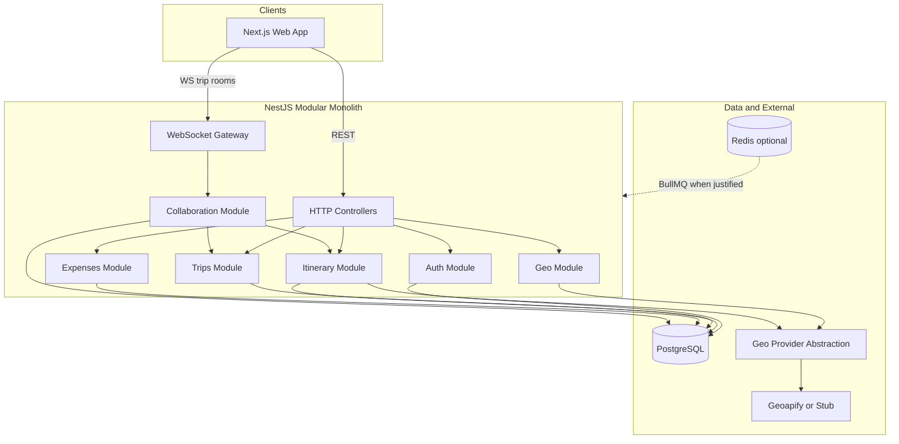
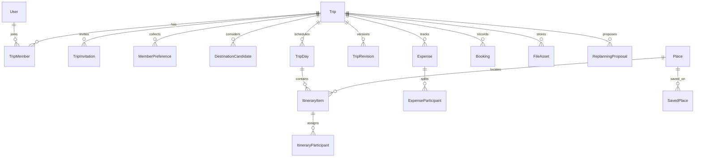

# Roamly — System Architecture

## Architectural overview

Roamly ships as a **modular monolith**: one NestJS application (`apps/api`) and one Next.js application (`apps/web`), sharing types via `packages/shared`. PostgreSQL holds all durable trip and user state. External geo services are optional adapters; their outage must not block reading or editing saved trip content except features that strictly require live routing.

## Architecture principles (enforcement)

| Principle | Implementation |
|-----------|----------------|
| Modular monolith | Nest modules with explicit exports; no cross-module repository leakage |
| Logic out of controllers | Controllers: auth, validation, HTTP mapping → services |
| Testable algorithms | `packages/itinerary-engine`, pure functions for expenses settlement |
| PostgreSQL source of truth | All trip mutations persist before WS broadcast |
| WebSockets | Notify success + revision; client refetch/merge |
| Trip resource protection | Global `TripMembershipGuard` + role metadata on routes |
| Itinerary versioning | `TripRevision` on material changes |
| External API resilience | Stub provider, cached geo responses, UI degradation |
| Optional expensive integrations | Feature flags; matrix jobs async when Redis/BullMQ added |
| No AI in deterministic rules | Scoring/replan heuristics documented and unit-tested |
| Avoid overengineering | No microservices, no event sourcing for v1 |

## Proposed NestJS module boundaries

Modules align with product domains. Dependencies flow **inward**: itinerary depends on trips and geo contracts; not the reverse.

| Module | Responsibility | Depends on |
|--------|----------------|------------|
| **Config** | Env validation, feature flags | — |
| **Database** | Prisma module, transactions | Config |
| **Auth** | Users, sessions, guards | Database |
| **Trips** | Trip CRUD, TripMember, lifecycle | Auth, Database |
| **Invitations** | TripInvitation, accept/decline | Trips, Auth, Notifications (optional) |
| **Preferences** | MemberPreference, aggregates | Trips |
| **Destinations** | DestinationCandidate, Poll, Vote, compatibility service | Preferences, Trips |
| **Geo** | Provider registry, caching, Place persistence helpers | Config, Database |
| **Places** | SavedPlace, trip place lists | Trips, Geo |
| **Itinerary** | TripDay, ItineraryItem, participants, revisions | Trips, Places, Geo (travel time) |
| **Optimisation** | Ordering suggestions, conflict reports | Itinerary, itinerary-engine package |
| **Collaboration** | WS gateway, room join, broadcast after commit | Trips, Itinerary |
| **Expenses** | Expense, splits, settlements | Trips |
| **Bookings** | Booking records | Trips, Files |
| **Files** | FileAsset upload metadata, storage adapter | Trips, Auth |
| **LiveTrip** | Today aggregation queries | Itinerary, Bookings |
| **Replanning** | ReplanningProposal, approval apply | Itinerary, Optimisation, Bookings |
| **Memories** | TripMemory, template export | Trips, Itinerary |
| **Notifications** | In-app notification records | Trips, Auth |

**Shared kernel (packages):**

- `@roamly/shared` — Zod schemas, enums (roles, trip status, item types)
- `@roamly/itinerary-engine` — compatibility math, conflict detection, TSP-like heuristics
- `@roamly/geo-contracts` — provider interfaces

## Request flow (typical mutating itinerary change)

1. Client sends REST mutation with `expectedRevision` (or `If-Match`).
2. Guard verifies JWT/session and **TripMember** role allows edit.
3. **ItineraryService** runs in transaction: validate items, write rows, bump `TripRevision`.
4. Transaction commits.
5. **CollaborationService** emits WS event `{ tripId, revisionNumber, type: 'itinerary.updated' }`.
6. Clients invalidate TanStack Query keys scoped to `tripId`.

## Initial data model

Conceptual relational model (not Prisma syntax). IDs are UUIDs unless noted.

### Core identity

**User**

- `id`, `email` (unique), `passwordHash` (nullable if OAuth-only later), `displayName`, `createdAt`, `updatedAt`
- Ownership: user owns their row; no trip coupling

**Session** (if server-side sessions)

- `id`, `userId`, `tokenHash`, `expiresAt`, `createdAt`
- FK: `userId → User` (cascade delete)

### Trip shell

**Trip**

- `id`, `title`, `description`, `status` (enum: draft, planning, active, completed, archived)
- `startDate`, `endDate` (date), `timezone` (IANA string)
- `defaultCurrency` (char(3))
- `createdById`, `createdAt`, `updatedAt`
- FK: `createdById → User`
- Ownership: accessible only via **TripMember**; creator is initial organizer

**TripMember**

- `id`, `tripId`, `userId`, `role` (organizer | member | viewer)
- `joinedAt`
- **Unique:** `(tripId, userId)`
- FK: `tripId → Trip`, `userId → User`
- Rule: at least one organizer per trip (enforced in service layer)

**TripInvitation**

- `id`, `tripId`, `email`, `role`, `tokenHash`, `status` (pending | accepted | declined | expired)
- `invitedById`, `expiresAt`, `createdAt`
- **Unique:** `(tripId, email)` where status pending (partial unique pattern or app-level check)
- FK: `tripId → Trip`, `invitedById → User`

### Preferences and destinations

**MemberPreference**

- `id`, `tripId`, `userId`
- `availabilityJson` (structured windows), `budgetMinor` (nullable), `budgetCurrency`, `hardConstraintsJson`, `softPreferencesJson`
- **Unique:** `(tripId, userId)`
- FK: `tripId → Trip`, `userId → User` (must be TripMember)

**DestinationCandidate**

- `id`, `tripId`, `name`, `regionCode` (optional), `centerLat`, `centerLng`
- `metadataJson` (climate tags, cost tier, source notes)
- `createdAt`
- FK: `tripId → Trip`

**Poll**

- `id`, `tripId`, `question`, `pollType` (destination | generic), `closesAt`, `createdById`
- FK: `tripId → Trip`

**Vote**

- `id`, `pollId`, `userId`, `destinationCandidateId` (nullable), `choiceJson`
- **Unique:** `(pollId, userId)`
- FK: `pollId → Poll`, `userId → User`, optional `destinationCandidateId`

Compatibility scores may be **computed on read** and cached ephemerally; persist only if needed for audit (`DestinationScoreSnapshot` deferred unless product requires historical ranking).

### Places

**Place**

- Canonical place record: `id`, `provider`, `providerPlaceId`, `name`, `lat`, `lng`, `addressJson`, `categoriesJson`, `rawProviderJson` (optional)
- **Unique:** `(provider, providerPlaceId)`

**SavedPlace**

- `id`, `tripId`, `placeId`, `notes`, `addedById`, `createdAt`
- **Unique:** `(tripId, placeId)` optional if duplicates allowed with different notes — default **unique (tripId, placeId)**
- FK: `tripId → Trip`, `placeId → Place`

### Itinerary

**TripDay**

- `id`, `tripId`, `date`, `label` (optional)
- **Unique:** `(tripId, date)`
- FK: `tripId → Trip`

**ItineraryItem**

- `id`, `tripDayId`, `sortOrder`, `itemType` (activity | transit | meal | lodging | buffer | custom)
- `title`, `placeId` (nullable), `startTime`, `endTime` (nullable, local trip TZ)
- `durationMinutes`, `isLocked`, `notes`
- `createdAt`, `updatedAt`
- FK: `tripDayId → TripDay`, `placeId → Place`

**ItineraryParticipant**

- `id`, `itineraryItemId`, `userId`
- **Unique:** `(itineraryItemId, userId)`
- FK: item and User (member of trip enforced in service)

**TripRevision**

- `id`, `tripId`, `revisionNumber` (integer, monotonic per trip)
- `summary`, `createdById`, `createdAt`, `snapshotJson` (optional diff or full snapshot — start with diff metadata + item ids)
- **Unique:** `(tripId, revisionNumber)`
- FK: `tripId → Trip`

Current revision pointer: store `currentRevisionNumber` on **Trip** or derive from max — **DECISION NEEDED**; recommendation: column on `Trip` updated in same transaction as new revision.

### Wallet

**Expense**

- `id`, `tripId`, `paidById`, `amountMinor`, `currency`, `description`, `expenseDate`, `createdAt`
- FK: `tripId → Trip`, `paidById → User`

**ExpenseParticipant**

- `id`, `expenseId`, `userId`, `shareMinor` (for custom split) or `splitType` at expense level
- Expense-level: `splitMode` (equal | custom | payer_only)
- **Unique:** `(expenseId, userId)` when participant in split
- FK: `expenseId → Expense`

**Settlement**

- `id`, `tripId`, `fromUserId`, `toUserId`, `amountMinor`, `currency`, `status` (suggested | marked_paid)
- Computed suggestions stored for UX stability; recompute invalidates old `suggested` rows
- FK: `tripId → Trip`

### Bookings and files

**Booking**

- `id`, `tripId`, `title`, `confirmationCode`, `startsAt`, `endsAt`, `linkedItineraryItemId` (nullable)
- `vendorName`, `notes`, `createdById`
- FK: `tripId → Trip`

**FileAsset**

- `id`, `tripId`, `uploadedById`, `storageKey`, `filename`, `mimeType`, `sizeBytes`, `createdAt`
- Optional FK to `bookingId` or `itineraryItemId`
- FK: `tripId → Trip`

### Replanning and memories

**ReplanningProposal**

- `id`, `tripId`, `baseRevisionNumber`, `proposedRevisionPayloadJson`, `status` (pending | approved | rejected)
- `reason`, `createdById` (system user id or member), `reviewedById`, `reviewedAt`
- FK: `tripId → Trip`

**TripMemory**

- `id`, `tripId`, `authorId`, `body`, `memoryDate`, `createdAt`
- Optional link to `placeId` or `itineraryItemId`
- FK: `tripId → Trip`

### Entity relationship summary

### Ownership and authorization rules

- **User**: self read/update only (except admin — out of scope).
- **Trip**: read/write iff **TripMember**; delete/archive organizer only.
- **Child entities** (`ItineraryItem`, `Expense`, etc.): inherit `tripId`; guards load trip membership once per request.
- **Invitations**: accept creates **TripMember**; token single-use.
- **Files**: download only with trip membership; storage keys never guessable (UUID paths).

## Critical engineering problems

### A. Group destination compatibility

**Hard vs soft**

- Hard constraints filter candidates (budget max, forbidden regions, date incompatibility from **MemberPreference.availabilityJson**). Failures appear in explanation list.
- Soft preferences contribute weighted score components (interest tags, pace, climate).

**Individual suitability**

- For each `(member, candidate)`, compute `score_i ∈ [0, 100]` from soft matches minus penalties for near-hard misses (e.g. slightly over budget intent).

**Group satisfaction and fairness**

- **Aggregate**: e.g. weighted average with organizer-adjustable weights default equal.
- **Fairness**: track `min_i score_i`; ranking penalizes low min (max-min fairness lite) so one unhappy member drops rank.
- Document formula in `itinerary-engine` tests with fixed fixtures.

**Explainable ranking**

- API returns ordered list with per-candidate: `groupScore`, `memberBreakdown[]`, `failedHard[]`, `warnings[]`.
- No ML; rules are versioned code.

### B. Itinerary planning

**Inputs**

- Items with duration, optional fixed start, **isLocked**, place coordinates, opening hours in `Place` metadata when available.

**Travel time**

- Pairwise durations from geo provider or haversine fallback with speed assumption; cache `(placeIdA, placeIdB, profile)` in DB or Redis TTL.

**Conflicts**

- Overlapping `[start, end)` on same day; travel gap insufficient between consecutive items; outside opening hours → `ConflictReport` with severity.

**Locked activities**

- Optimiser must not move locked items; may still flag impossible schedules.

**Route order**

- Per day: heuristic (nearest-neighbor seed + 2-opt local search) on unlocked items with fixed anchors.
- Document **limitations**: not globally optimal; multi-day order separate; no traffic live unless provider supports and is enabled.

**Opening hours**

- When missing, skip constraint; UI shows “hours unknown.”

### C. Collaborative editing

**Rooms**

- WS channel `trip:{tripId}`; join only after auth + membership verified.

**Database-first**

- All edits REST → transaction → commit → broadcast.

**Revision numbers**

- Monotonic `TripRevision.revisionNumber`; client sends `expectedRevision` on mutate.

**Optimistic concurrency**

- Mismatch → `409 Conflict` with server revision; client merges or refetches.

**Conflicting updates**

- Last-writer-wins **avoided** for itinerary; revision gate forces explicit retry.
- Optional: field-level merge for notes only in later iteration.

### D. Expenses

**Storage**

- All amounts `bigint` minor units; currency per expense matching trip default unless overridden.

**Splits**

- **Equal**: `shareMinor = floor(total/n)`; remainder assigned by stable userId order (document algorithm).
- **Custom**: sum of `shareMinor` must equal `amountMinor`.
- **Payer only**: only `paidById` liable; others informational zero.

**Net balance**

- Per user: `paid - owed`; graph simplified to **Settlement** suggestions via greedy min-cash-flow or standard debt reduction — pure function in tests.

**Participant-based**

- Only **ExpenseParticipant** users included in owed calculation for that expense.

### E. Adaptive replanning

**Trigger**

- User reports disruption (delay minutes, closed place) or bulk “replan day.”

**Affected activities**

- Graph walk from changed item: overlapping items, downstream travel infeasible, same `placeId` closures.

**Preserve bookings**

- Items linked to **Booking** with confirmed status or `isLocked` excluded from auto-move; proposals flag manual review if conflict.

**Alternatives**

- Search **SavedPlace** + nearby **Place** search (if geo up); substitute same `itemType` and similar duration heuristics.

**Versioned proposals**

- **ReplanningProposal** stores JSON patch against `baseRevisionNumber`; approval applies patch in transaction, new **TripRevision**, reject leaves current.

**Human approval**

- Organizer (or configurable role) must `approve`; members may `suggest` only if product allows — initial: organizer approves.

## Frontend architecture (web)

- **App Router** route groups: `(auth)`, `(app)/trips/[tripId]/...`
- **TanStack Query** keys: `['trip', id]`, `['itinerary', tripId, revision]`
- **MapLibre** in client components; token/source from public env
- **shadcn/ui** for layout, forms, dialogs (polls, proposals)
- Optimistic updates only where revision retry UX is implemented (M7+)

## Degradation matrix

| Failure | User impact |
|---------|-------------|
| Geoapify down | Search/route disabled; saved places and manual items work |
| WS disconnect | Polling fallback optional; REST still authoritative |
| DB up | Full functionality |

## Security summary

- HTTPS only in prod; httpOnly cookies if session-based
- CSRF for cookie auth; SameSite strict
- Rate limit auth and invitation endpoints
- File upload size/type allowlist

---

*Related documents: [PRODUCT_SPEC.md](./PRODUCT_SPEC.md), [ROADMAP.md](./ROADMAP.md), [ENGINEERING_DECISIONS.md](./ENGINEERING_DECISIONS.md)*
