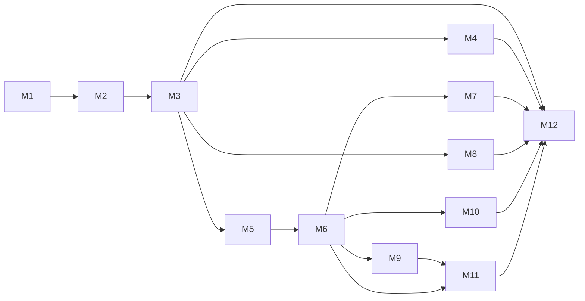

# Roamly — Development Roadmap

Phased delivery from product definition through production release. Milestones **M1–M12** are independently verifiable: each defines scope, engineering work, dependencies, acceptance criteria, and testing expectations.

Capability map (unchanged product vision): create trip → preferences → destination intelligence → maps → itinerary → collaboration → wallet → bookings/documents → live trip → replanning → memories/release.

---

## M1 — Product definition and architecture

### Objective

Establish an implementation-ready product and technical blueprint before code.

### Scope

- Document product vision, domains, data model concepts, algorithms, security, and phased delivery.
- Finalize agreed decisions (sessions, revision concurrency, geo abstraction, recommendation snapshots, storage abstraction, WS/deployment posture).
- No application source, dependencies, or database migrations.

### Important engineering work

- Author and align `docs/PRODUCT_SPEC.md`, `ARCHITECTURE.md`, `ENGINEERING_DECISIONS.md`, `ROADMAP.md`.
- Add root `README.md` and `IMPLEMENTATION_STATUS.md`.
- Resolve prior doc contradictions (JWT vs session, revision pointer, snapshot persistence).

### Dependencies

None.

### Acceptance criteria

- [ ] All docs internally consistent with agreed architectural decisions.
- [ ] Auth vs authorization, RBAC, transactions, 409 concurrency, idempotency, jobs, and degradation documented in ARCHITECTURE.
- [ ] Recommendation snapshots and `Trip.itineraryRevisionNumber` specified.
- [ ] No application code or package installation.

### Testing expectations

None (documentation-only).

---

## M2 — Project foundation

### Objective

Bootstrap the monorepo and developer environment so feature work can begin safely.

### Scope

- pnpm workspaces, empty `apps/web` and `apps/api`, shared packages stubs.
- Docker Compose PostgreSQL; documented local startup.
- CI pipeline (lint, typecheck, smoke tests).
- Placeholder web home and API `/health`.

### Important engineering work

- **Backend:** NestJS Config module, env validation, health controller, Prisma module wired without feature schema (or empty migration only if required for tooling).
- **Frontend:** Next.js App Router, Tailwind, shadcn init, TanStack Query provider.
- **Shared:** `packages/shared` scaffold; export placeholder types.
- **Packages:** create empty `packages/geo-contracts` and `packages/itinerary-engine` with test runner configured.
- **Infra:** GitHub Actions workflow; `.env.example` without secrets.

### Dependencies

M1 complete.

### Acceptance criteria

- [ ] `pnpm install` and compose-up documented in README.
- [ ] CI green on default branch for lint/typecheck/smoke.
- [ ] No trip/auth/feature modules beyond health/config.

### Testing expectations

- Supertest: `GET /health` → 200.
- Optional Playwright: home page renders.

---

## M3 — Authentication and trip management

### Objective

Secure identity, trip creation, invitations, and **server-side trip membership enforcement** on all trip routes.

### Scope

- Register, login, logout, session expiration/revocation.
- Create and list trips; invite and accept members; roles (organizer, member, viewer).
- User-visible: auth pages, trip list, trip overview, member list, invite/accept flows.

### Important engineering work

- **Backend:** Auth module — argon2/bcrypt, Session with hashed tokens, httpOnly cookies, CSRF + origin checks. Trips + Invitations modules. Guards: session, trip membership, trip roles. Prisma: User, Session, Trip, TripMember, TripInvitation. Initialize `Trip.itineraryRevisionNumber` (default 0 or 1).
- **Frontend:** Auth forms (RHF + Zod shared schemas), trip CRUD UI, invitation flows.
- **Security:** Rate limit auth endpoints; never trust client `userId` for authorization.

### Dependencies

M2.

### Acceptance criteria

- [ ] Unauthenticated trip access returns 401/403 as appropriate.
- [ ] Non-member cannot read or mutate trip resources.
- [ ] Invitation accept is idempotent; unique membership per user per trip.
- [ ] At least one organizer invariant enforced.
- [ ] Session/JWT ambiguity removed — sessions only.

### Testing expectations

- Unit: invitation expiry; membership uniqueness.
- Supertest: CSRF failure on mutate without token; non-member 403; accept invite twice safe.
- Playwright: register → create trip → invite/accept with second user.

---

## M4 — Group intelligence

### Objective

Collect group preferences, compare destinations with **explainable deterministic scoring**, and run polls/votes—with **persisted recommendation snapshots**.

### Scope

- Member preference forms; destination candidates; ranked compatibility with breakdowns; polls/votes.
- User-visible: preference wizard, comparison UI with explanations, poll/vote UI, snapshot history (latest default).

### Important engineering work

- **Backend:** Preferences, Destinations modules. Integrate `@roamly/itinerary-engine` for scoring. Persist **RecommendationSnapshot** (`algorithmVersion`, preference snapshot, candidate ids, score breakdown, timestamp). Poll/Vote CRUD.
- **Frontend:** Comparison tables/cards showing member breakdown and hard constraint failures.

### Dependencies

M3.

### Acceptance criteria

- [ ] Ranking API returns explainable breakdown, not a single opaque score.
- [ ] Each explicit (re)compute creates a persisted snapshot row.
- [ ] Hard constraint failures visible per candidate.
- [ ] `algorithmVersion` stored and visible for audit.

### Testing expectations

- Unit: engine fixtures for fairness and hard filters; version constant tests.
- Supertest: vote uniqueness; snapshot created on rank endpoint.
- Playwright: two members submit preferences → ranking and explanations visible.

---

## M5 — Maps and location discovery

### Objective

MapLibre map experience and provider-neutral geo integration with stub for tests; saved places on trips.

### Scope

- Search/geocode/places via abstraction; save places to trip; map display.
- User-visible: trip map, search, saved places list with notes.
- Saved trip data remains accessible when external provider unavailable.

### Important engineering work

- **Backend:** `@roamly/geo-contracts`; Geo module with Geoapify adapter + **StubGeoProvider**; cache layer; Places module (Place, SavedPlace). No business imports of vendor SDK outside adapter.
- **Frontend:** MapLibre component; degraded UI when provider errors.

### Dependencies

M3.

### Acceptance criteria

- [ ] CI uses stub provider only.
- [ ] Non-member cannot save places.
- [ ] Trip workspace loads without live geo calls.

### Testing expectations

- Unit: stub fixtures; cache key behavior.
- Supertest: save place upserts canonical Place + SavedPlace.
- Playwright: mocked search → save → list (or stub-backed E2E).

---

## M6 — Itinerary engine

### Objective

Day-based itinerary with travel times, conflicts, heuristic route order, **revision history**, and **optimistic concurrency**.

### Scope

- Trip days and items; locks; participants; optimise order suggestion; revision list.
- User-visible: timeline/day view, conflict badges, optimise confirm flow.

### Important engineering work

- **Backend:** Itinerary + Optimisation modules. Transaction: mutate + `TripRevision` + increment `Trip.itineraryRevisionNumber`. Require `expectedRevision`; 409 on stale. Travel time via geo or fallback; engine for conflicts/heuristics. Optional BullMQ job for routing matrix when Redis enabled.
- **Frontend:** Drag reorder (unlocked), lock toggle, display heuristic limitations.

### Dependencies

M3, M5.

### Acceptance criteria

- [ ] Material changes append TripRevision and bump trip revision in one transaction.
- [ ] Stale `expectedRevision` returns 409 with current revision.
- [ ] Routing failure still allows manual scheduling.
- [ ] Optimisation does not move locked items.

### Testing expectations

- Unit: conflict detection; route heuristic golden sets; locked item tests.
- Supertest: concurrent mutate → one success one 409.
- Playwright: add items → conflict shown → optimise order.

---

## M7 — Collaboration

### Objective

Real-time trip updates via WebSockets **after DB commit**; revision-aware client UX.

### Scope

- Multi-client refresh; conflict toasts on 409.
- User-visible: second browser sees changes without manual refresh (when connected).

### Important engineering work

- **Backend:** Collaboration module — WS gateway, `trip:{id}` rooms, session auth on connect, membership check. Emit events post-commit only. Single API instance (no Redis adapter yet).
- **Frontend:** WS hook + TanStack Query invalidation; 409 refetch path.

### Dependencies

M6.

### Acceptance criteria

- [ ] No WebSocket-only persistence.
- [ ] Events include `itineraryRevisionNumber` for itinerary changes.
- [ ] Non-member cannot join room.

### Testing expectations

- Integration: mutate → WS client receives event after commit.
- Supertest/WS: reject unauthenticated or non-member.
- Playwright: two contexts; edit propagates or 409 handled.

---

## M8 — Wallet

### Objective

Shared expenses, splits, net balances, and settlement suggestions (informational, not payments).

### Scope

- Add/edit expenses, equal/custom splits, balance summary, mark settlements.
- User-visible: expense list, create form, who owes whom.

### Important engineering work

- **Backend:** Expenses module; minor-unit storage; settlement recompute in transaction; optional Idempotency-Key on create.
- **Frontend:** Split mode UI, balances panel.
- **Engine:** settlement reduction in `@roamly/itinerary-engine` or shared pure util with tests.

### Dependencies

M3.

### Acceptance criteria

- [ ] All amounts integer minor units; custom splits sum to total.
- [ ] No payment gateway.
- [ ] Settlement algorithm documented and unit-tested.

### Testing expectations

- Unit: remainder assignment edge cases.
- Supertest: invalid split rejected; idempotency replay (if implemented).
- Playwright: two expenses → balances match spreadsheet.

---

## M9 — Bookings and documents

### Objective

Manual bookings (with **confirmed** flag for replan rules) and file uploads via **storage abstraction**.

### Scope

- Booking CRUD linked to itinerary items; upload/download documents.
- User-visible: booking form, file list, secure download.

### Important engineering work

- **Backend:** Bookings module with `isConfirmed`. Files module — **LocalStorageAdapter**, FileAsset metadata, proxied download with membership guard. Upload transaction: DB row then stream; rollback on failure.
- **Frontend:** Upload component, booking UI.

### Dependencies

M3; M6 for optional item link.

### Acceptance criteria

- [ ] Confirmed bookings documented for M11 protection.
- [ ] Binaries not stored in PostgreSQL.
- [ ] Non-member cannot download.

### Testing expectations

- Supertest: size/type limits; auth on download.
- Playwright: member uploads; other member can download.

---

## M10 — Live trip

### Objective

Travel-day command center for **active** trips.

### Scope

- Today schedule, next item, links to map/bookings; optional check-off.
- User-visible: “Today” tab when trip active; mobile-friendly layout.

### Important engineering work

- **Backend:** LiveTrip read service; timezone-aware “today”; gate by trip status active.
- **Frontend:** Live dashboard; organizer status transitions planning → active → completed.

### Dependencies

M6; M9 recommended.

### Acceptance criteria

- [ ] Does not require live routing provider.
- [ ] Only members of active trip access live endpoints.

### Testing expectations

- Unit: timezone boundary for today.
- Supertest: inactive trip denied.
- Playwright: activate trip → today shows correct items.

---

## M11 — Adaptive replanning

### Objective

Disruption → affected activities → **versioned proposal** → **organizer approval** → transactional apply.

### Scope

- Report delay/closure; review diff; approve/reject.
- Preserve **confirmed bookings** and **locked** itinerary items.

### Important engineering work

- **Backend:** Replanning module; engine for affected set and alternatives; ReplanningProposal tied to `baseRevisionNumber`; approve in one transaction with revision bump. Optional BullMQ for heavy analysis.
- **Frontend:** Proposal review and approval UI.

### Dependencies

M6, M9; M5 for geo-backed alternatives when available.

### Acceptance criteria

- [ ] No auto-apply without organizer approval.
- [ ] Confirmed bookings not silently moved by proposal apply.
- [ ] Reject leaves revision unchanged.

### Testing expectations

- Unit: affected detection; booking/lock preservation.
- Supertest: approve bumps revision; reject does not.
- Playwright: full propose → approve flow.

---

## M12 — Memories and production release

### Objective

Post-trip memories, trip templates, production hardening, and **deployment documentation**.

### Scope

- Memory journal; clone trip structure to template; production release checklist.
- User-visible: memories UI, create trip from template.
- **Create `docs/DEPLOY.md`** (detailed hosting, migrations, secrets, TLS, storage) — production provider choices made here, not before.

### Important engineering work

- **Backend:** Memories module; template clone rules (exclude members, expenses, personal files). Production storage adapter implementation when vendor chosen. Redis/BullMQ if async features enabled. Security checklist execution.
- **Frontend:** Memories, template flows, error boundaries.
- **Ops:** DEPLOY.md; dependency audit; rate limits verified.

### Dependencies

M3–M11 per included features.

### Acceptance criteria

- [ ] Completed/archived trips support memories.
- [ ] Template clone scope documented (included/excluded entities).
- [ ] `docs/DEPLOY.md` exists with no premature vendor lock-in before this milestone.
- [ ] Playwright regression covers critical paths.

### Testing expectations

- Playwright regression suite (M3–M11 subset).
- Optional load smoke; not a full perf program.

---

## Milestone dependency graph

## Cross-milestone quality bar

| Concern | First enforced |
|---------|----------------|
| Trip membership guards | M3+ |
| Shared Zod contracts | M3+ |
| itinerary-engine unit tests | M4, M6, M8, M11 |
| Recommendation snapshots | M4 |
| `expectedRevision` / 409 | M6 |
| Post-commit WS | M7 |
| Storage abstraction | M9 |
| DEPLOY.md | M12 |

---

*Related: [PRODUCT_SPEC.md](./PRODUCT_SPEC.md), [ARCHITECTURE.md](./ARCHITECTURE.md), [ENGINEERING_DECISIONS.md](./ENGINEERING_DECISIONS.md), [../IMPLEMENTATION_STATUS.md](../IMPLEMENTATION_STATUS.md)*
