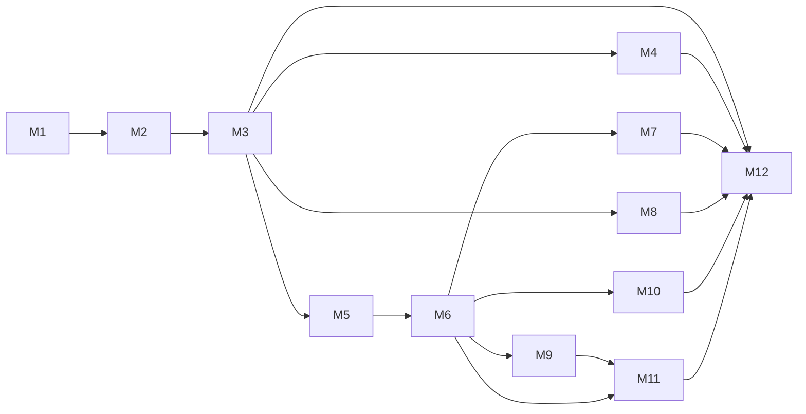

# Roamly — Development Roadmap

Phased delivery from product definition through production-ready release. Milestones are sequential unless noted; parallel work within a milestone is allowed when dependencies are met.

**Legend:** M1–M12 map to the phases in the product brief.

---

## M1 — Product definition and architecture

### Objective

Align product scope, domain boundaries, data model, engineering approaches, and stack before code.

### User-visible outcome

None (documentation only).

### Backend responsibilities

None.

### Frontend responsibilities

None.

### Important tests

None.

### Dependencies

None.

### Acceptance criteria

- [ ] `docs/PRODUCT_SPEC.md`, `ARCHITECTURE.md`, `ROADMAP.md`, `ENGINEERING_DECISIONS.md` complete and consistent.
- [ ] Foundational vs later domains identified.
- [ ] Critical problems A–E documented with testable approaches.
- [ ] No application code or dependency installation.

---

## M2 — Project foundation

### Objective

Bootstrap pnpm monorepo, Docker Compose for PostgreSQL, CI skeleton, and empty app shells with health checks.

### User-visible outcome

Developer can clone, `pnpm install`, start DB and apps, see API health and web placeholder home.

### Backend responsibilities

- NestJS app with Config, Database (Prisma migrate empty or User-only stub migration deferred to M3), health module.
- Env validation schema.
- Supertest smoke test for `/health`.

### Frontend responsibilities

- Next.js App Router, Tailwind, shadcn init, layout shell.
- TanStack Query provider wiring (no trip data yet).

### Important tests

- CI: lint, typecheck, unit smoke.
- Supertest: health endpoint.
- Playwright: home page loads (optional smoke).

### Dependencies

M1 complete.

### Acceptance criteria

- [ ] pnpm workspaces: `apps/web`, `apps/api`, `packages/shared`.
- [ ] Docker Compose PostgreSQL documented in README.
- [ ] GitHub Actions runs on PR.
- [ ] No feature modules beyond health/config.

---

## M3 — Authentication and trip management

### Objective

Users authenticate; create trips; invite and accept members; enforce membership on all trip routes.

### User-visible outcome

Sign up/in, create trip, invite by email/link, accept invite, see trip list and trip overview with member list and roles.

### Backend responsibilities

- Auth module (strategy per ENGINEERING_DECISIONS once chosen).
- Trips, TripMember, Invitations modules.
- Guards: authenticated, trip member, organizer where needed.
- Prisma schema for User, Session (if used), Trip, TripMember, TripInvitation.

### Frontend responsibilities

- Auth pages, trip list, create trip form, trip settings, invite flow, accept invite page.
- React Hook Form + Zod shared schemas.

### Important tests

- Unit: invitation token expiry, unique membership.
- Supertest: unauthorized trip access 403; accept invite idempotency.
- Playwright: register → create trip → invite second user (test mailbox or seeded token).

### Dependencies

M2.

### Acceptance criteria

- [ ] Every trip endpoint verifies membership server-side.
- [ ] At least one organizer invariant enforced.
- [ ] Session/JWT decision implemented and documented.

---

## M4 — Group intelligence

### Objective

Collect member preferences; add destination candidates; run explainable compatibility ranking; polls/votes.

### User-visible outcome

Preference forms per member; destination list with scores and explanations; poll to choose destination.

### Backend responsibilities

- Preferences, Destinations modules.
- Compatibility service using `@roamly/itinerary-engine` (pure functions).
- Poll/Vote CRUD; aggregate results.

### Frontend responsibilities

- Preference wizard, destination comparison table/cards with member breakdown.
- Poll UI and vote submission.

### Important tests

- Unit: scoring and fairness fixtures; hard constraint filtering.
- Supertest: only members vote once; preference upsert unique per trip/user.
- Playwright: two members set preferences → ranking visible with explanations.

### Dependencies

M3.

### Acceptance criteria

- [ ] Ranking API returns explainable breakdown (no opaque single number only).
- [ ] Hard constraint failures visible on candidates.

---

## M5 — Maps and location discovery

### Objective

Integrate MapLibre; geo provider abstraction with Geoapify implementation and stub; save places to trip.

### User-visible outcome

Map on trip; search places; save to trip list; view saved places with notes.

### Backend responsibilities

- Geo module: provider interface, cache layer, Geoapify + stub.
- Places module: Place upsert from provider, SavedPlace CRUD.

### Frontend responsibilities

- MapLibre map component, search autocomplete, saved places panel.
- Graceful error when provider disabled.

### Important tests

- Unit: stub provider returns fixtures; cache key behavior.
- Supertest: save place creates canonical Place + SavedPlace; non-member denied.
- Playwright: search (mocked API) → save → appears in list.

### Dependencies

M3 (M4 optional for trip context but trip shell required).

### Acceptance criteria

- [ ] No Nest service imports Geoapify SDK directly outside geo adapter.
- [ ] Trip readable when provider stubbed in CI.

---

## M6 — Itinerary engine

### Objective

Build day-based itinerary with items, locks, travel times, conflicts, route-order suggestions, revisions.

### User-visible outcome

Calendar/day view; add/edit/reorder items; see travel gaps and conflicts; “optimise order” suggestion; revision history list.

### Backend responsibilities

- Itinerary + Optimisation modules.
- TripDay, ItineraryItem, ItineraryParticipant, TripRevision.
- Travel time via geo provider or fallback; `@roamly/itinerary-engine` for conflicts and 2-opt/heuristic order.
- `expectedRevision` concurrency.

### Frontend responsibilities

- Day timeline UI, drag reorder (unlocked items), lock toggle, conflict badges.
- Optimise button applies suggestion after confirm.

### Important tests

- Unit: conflict detection, locked item immobility, equal split remainder (if shared util).
- Unit: route heuristic on small fixed coordinate sets.
- Supertest: 409 on stale revision; revision increments on change.
- Playwright: add items → detect conflict → optimise order.

### Dependencies

M5 (places/coords); M3.

### Acceptance criteria

- [ ] Material changes create TripRevision.
- [ ] Optimisation documented as heuristic; UI sets expectations.
- [ ] External routing failure still allows manual item times.

---

## M7 — Collaboration

### Objective

Real-time notifications of trip changes via WebSockets after persistence; optimistic concurrency UX.

### User-visible outcome

Multiple browsers on same trip see updates within seconds; conflict message on stale save.

### Backend responsibilities

- Collaboration module: WS gateway, trip room join auth, post-commit events.
- Event types: itinerary, places, expenses (later), generic trip updated.

### Frontend responsibilities

- WS client hook; Query invalidation on events.
- Conflict toast + refetch on 409.

### Important tests

- Integration: mutate itinerary → WS client receives event (test gateway).
- Supertest: WS connection rejected without membership.
- Playwright: two contexts edit trip; second sees first’s change after refresh or WS.

### Dependencies

M6 (itinerary revisions as backbone).

### Acceptance criteria

- [ ] No WS-only writes; disconnect does not lose data.
- [ ] Revision conflict path covered in E2E.

---

## M8 — Wallet

### Objective

Trip expenses, equal/custom splits, net balances, suggested settlements (informational).

### User-visible outcome

Add expense, assign participants, see who owes whom; mark settlement suggested/paid locally.

### Backend responsibilities

- Expenses module: Expense, ExpenseParticipant, Settlement computation job or sync on write.

### Frontend responsibilities

- Expense list, create form, split mode, balances summary, settlement list.

### Important tests

- Unit: settlement algorithm edge cases (0, single payer, remainder).
- Supertest: custom split must sum to total; currency matches trip default.
- Playwright: two expenses → balances match manual spreadsheet.

### Dependencies

M3.

### Acceptance criteria

- [ ] All money in minor integer units.
- [ ] No payment gateway integration.

---

## M9 — Bookings and documents

### Objective

Manual booking records linked to itinerary; file uploads with trip-scoped access.

### User-visible outcome

Add booking with confirmation code; attach PDF; link booking to itinerary item.

### Backend responsibilities

- Bookings, Files modules; storage adapter (local dev).
- FileAsset metadata; signed URL or proxied download with guard.

### Frontend responsibilities

- Booking CRUD UI; file upload component; document list.

### Important tests

- Supertest: non-member cannot download; file size limit enforced.
- Playwright: upload file → visible to another member on same trip.

### Dependencies

M6 (optional link to item); M3.

### Acceptance criteria

- [ ] Confirmed bookings referenced in replanning rules (prep for M11).
- [ ] Storage keys not exposed without auth.

---

## M10 — Live trip

### Objective

Travel-day command center for active trips: today’s schedule, quick navigation, check-off optional.

### User-visible outcome

“Today” tab when trip status active; highlights current/next item; links to map and bookings.

### Backend responsibilities

- LiveTrip module: read models aggregating today’s ItineraryItem, bookings, timezone-aware “now”.

### Frontend responsibilities

- Live trip dashboard; mobile-friendly layout.
- Status transition planning → active → completed (organizer).

### Important tests

- Unit: timezone boundary for “today”.
- Supertest: only active trip members access live endpoints.
- Playwright: set trip active → today view shows correct day items.

### Dependencies

M6, M9 recommended.

### Acceptance criteria

- [ ] Works offline from live routing (read cached itinerary).
- [ ] Trip status gates live features.

---

## M11 — Adaptive replanning

### Objective

Disruption input → affected items → proposal with alternatives → organizer approval → new revision.

### User-visible outcome

Report delay/closure; review proposal diff; approve or reject; itinerary updates on approve.

### Backend responsibilities

- Replanning module: rules in itinerary-engine; ReplanningProposal lifecycle; apply patch transactionally.
- Respect locked items and bookings.

### Frontend responsibilities

- Disruption form; proposal review UI (side-by-side or diff list); approve/reject actions.

### Important tests

- Unit: affected set detection; booking preservation.
- Supertest: approve applies revision; reject leaves revision unchanged.
- Playwright: propose → approve → itinerary reflects change.

### Dependencies

M6, M9; M5 for alternatives search when geo available.

### Acceptance criteria

- [ ] No auto-apply without approval.
- [ ] Proposal tied to `baseRevisionNumber`.

---

## M12 — Memories and production release

### Objective

Post-trip memories; template export from completed trip; production hardening and release checklist.

### User-visible outcome

Memory journal on completed trip; duplicate trip as template (structure without personal expenses); deployed prod environment.

### Backend responsibilities

- Memories module: TripMemory CRUD; template clone service (trip + days + item skeleton, not members/expenses).
- Production env docs; optional Redis if queue adopted; migration strategy.

### Frontend responsibilities

- Memories UI; “Save as template” / “Create trip from template”.
- Error boundaries, basic analytics hook placeholder (no vendor required).

### Important tests

- Full Playwright regression suite (critical paths M3–M11 subset).
- Load smoke optional (not full performance test).

### Dependencies

M3–M11 per feature scope.

### Acceptance criteria

- [ ] Completed trip can be archived with memories.
- [ ] Template clone documented (what copies, what excludes).
- [ ] Production deployment runbook in README or docs/DEPLOY.md (optional file — **DECISION NEEDED** if separate doc).
- [ ] Security checklist: HTTPS, secrets, rate limits, dependency audit.

---

## Milestone dependency graph

## Cross-milestone quality bar

| Concern | When introduced |
|---------|-----------------|
| Membership guards | M3+ all trip routes |
| Shared Zod schemas | M3+ |
| itinerary-engine unit tests | M4, M6, M11 |
| Playwright critical path | M3 smoke; expands each milestone |
| Geo stub in CI | M5+ |

---

*Related documents: [PRODUCT_SPEC.md](./PRODUCT_SPEC.md), [ARCHITECTURE.md](./ARCHITECTURE.md), [ENGINEERING_DECISIONS.md](./ENGINEERING_DECISIONS.md)*
